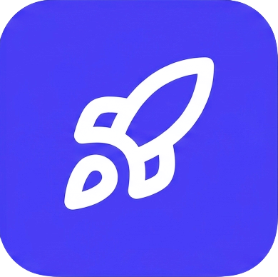

  

<h1 align="center">Nova CRM Mobile</h1>

  <strong>Aplicativo oficial e companheiro mobile da plataforma Nova CRM</strong> 
  Gestão comercial ágil, controle de vendas, clientes, catálogo e atendimento na palma da sua mão.

  
  
  
  

---

## 🚀 Sobre o Nova CRM

O **Nova CRM** é uma plataforma moderna e completa de gestão de relacionamento com o cliente (CRM) e automação comercial desenvolvida especialmente para lojistas, prestadores de serviços e empreendedores. 

Com foco em simplicidade, velocidade e produtividade, o ecossistema Nova CRM centraliza o fluxo de vendas, desde o primeiro contato do cliente até o pós-venda e fidelização.

O **Nova CRM Mobile** traz toda essa potência para o seu smartphone Android, permitindo acompanhar o seu negócio em tempo real em qualquer lugar.

---

## ✨ Principais Funcionalidades

- 📊 **Dashboard Comercial em Tempo Real**:
  - Resumo de faturamento total e ticket médio.
  - Volume de pedidos fechados e pendentes.
  - Gráficos visuais de evolução das vendas.

- 👥 **Gestão Completa de Clientes**:
  - Cadastro simplificado com dados de contato, e-mail e telefone.
  - Histórico de relacionamento e volume de compras por cliente.
  - Acesso direto ao atendimento.

- 📦 **Catálogo de Produtos & Controle de Estoque**:
  - Gerenciamento de itens, valores e descrições.
  - Controle de disponibilidade em estoque.
  - Busca rápida e filtros por categoria.

- 💬 **SAC & Chat ao Vivo com Clientes**:
  - Atendimento e conversas em tempo real integradas via Firebase Realtime Database.
  - Notificação de status "digitando" e mensagens instantâneas para suporte ágil aos compradores.

- 🧾 **Pedidos, Cupons e Orçamentos**:
  - Monitoramento de pedidos e transações.
  - Gestão e emissão de cupons promocionais para campanhas.
  - Geração de propostas e orçamentos em PDF com um toque.

- 📱 **Interface Moderna & Flexível**:
  - Desenvolvido 100% com **Jetpack Compose** e Material Design 3.
  - Suporte completo a orientação vertical (retrato) e horizontal (paisagem).
  - Experiência visual fluida e minimalista com Lucide Icons.

---

## 📥 Download e Instalação (APK)

Você pode instalar o aplicativo diretamente no seu dispositivo Android através da pasta `apk/` do projeto:

- 📦 **[apk/nova-crm.apk](apk/nova-crm.apk)**: Versão compilada pronta para teste e instalação.
- 📦 **[apk/app-debug.apk](apk/app-debug.apk)**: Pacote de depuração.

---

## 🛠️ Tecnologias Utilizadas

- **Kotlin** & **Coroutines / Flow** para operações assíncronas reativas.
- **Jetpack Compose** & **Material Design 3** para construção de interfaces declarativas.
- **Firebase Firestore** & **Firebase Realtime Database** para sincronização de dados em nuvem e chat ao vivo.
- **Architecture MVVM** (Model-View-ViewModel) para código desacoplado e escalável.

---

## 🌐 Saiba Mais e Assine

Para gerenciar o seu plano, contratar upgrades ou acessar o painel web administrativo completo, visite:

👉 **[https://novacrm.com.br](https://novacrm.com.br)**
